# Skyline — Xboard 专用高性能 MX 协议 Linux 后端

**Skyline** 是专为 **Xboard** 面板（配合 `MxProtocol` 插件）打造的 Linux 原生高性能 **MX (MundoConnect)** 协议后端代理服务。项目与官方 `M-master` 原版实现 100% 统一，支持 **Proxy Protocol v1 与 v2 协议头的发送与接收**，并将程序与配置文件统一存放在 **`/etc/skyline`** 目录下（`/etc/skyline/skyline` 与 `/etc/skyline/config.yml`），方便直接修改配置与运维管理。

---

## 一、目录结构与核心特性

### 1. `/etc/skyline` 统一存放规范
安装完成后，程序本体与配置文件全部集中在 `/etc/skyline` 目录：

```text
/etc/skyline/
├── skyline        # Skyline Linux 静态可执行程序本体 (同时创建软链接 /usr/local/bin/skyline)
├── config.yml     # 核心配置文件（可直接编辑修改，支持热重载）
└── certs/         # (可选) 存放节点自定义 TLS 证书与私钥
```

您可以随时直接编辑 `/etc/skyline/config.yml`，保存后执行 `skyline service reload` 或 `systemctl restart skyline` 即可立即生效。

### 2. 核心架构图

```mermaid
flowchart LR
    subgraph Xboard["Xboard 面板 (含 MxProtocol 插件)"]
        A1["/api/v1/server/UniProxy/*"]
        A2["/api/v2/server/*"]
    end

    subgraph Skyline["Skyline Linux 节点后端 (/etc/skyline)"]
        B1["Panel Client (ETag 304 缓存)"]
        B2["Node Manager (单节点 / 多节点 / 机器发现)"]
        B3["Skyline Dispatcher (令牌桶限速 / 设备IP限制 / 路由拦截)"]
        B4["MX Protocol Engine (与 M-master 官方原版 100% 统一)"]
        B5["Proxy Protocol Engine (支持 v1 & v2 发送与接收)"]
    end

    subgraph Transports["6 种传输层 & 3 种安全层"]
        C1["TCP / WS / gRPC"]
        C2["XHTTP (JATP) / MC1 / MundoRDP"]
        C3["Plain / TLS (自动自签或PEM) / REALITY"]
    end

    Xboard <-->|"拉取配置/用户 & 上报流量/在线IP/负载"| B1
    B1 --> B2 --> B3 --> B4 --> B5 --> Transports
```



### 3. 与官方 `M-master` 原版实现 100% 统一
- **帧格式与字节序完全一致**：`versionMX = 1`、36 字节归一化 Token/UUID、命令码 `0x01` (TCP) / `0x02` (UDP)、`PortThenAddress` 编码（2 字节大端端口 + 地址类型 `0x01` IPv4 / `0x04` IPv6 / `0x03` 域名）、2 字节大端长度前缀 UDP 报文。
- **FastAuth 0-RTT 快速认证完全统一**：完整实现 `MundoConnect-Auth` 请求头（`1|mx|<token>|<net>|<host>|<port>|<net>`）与 `MundoConnect-Response: ok / fail` 响应头，支持 `ResultadoAutenticacionRapida` 与 `SesionAutenticacionRapida` 省去经典握手头部，并与 `M-master` 的 `procesarUDPDirigidoConEnlace` 定向 UDP 隧道完全一致。
- **WebSocket EarlyData 与真实 IP 透传一致**：支持 `Sec-WebSocket-Protocol` / URL Base64 早期数据、`X-Forwarded-For` 解析以及入站/出站 **Proxy Protocol v1 & v2**。

---

## 二、Proxy Protocol v1 & v2 协议头支持（发送与接收）

Skyline 完整支持 **Proxy Protocol v1（文本格式）** 和 **Proxy Protocol v2（二进制格式）** 的**出站发送**与**入站接收解析**，可直接通过修改 `/etc/skyline/config.yml` 配置：

### 1. 在 `/etc/skyline/config.yml` 中配置发送与接收

```yaml
# =============================================================================
# Proxy Protocol v1 & v2 协议头配置 (/etc/skyline/config.yml)
# =============================================================================

# 1. 发送 Proxy Protocol 协议头 (proxy_protocol 或 send_proxy_protocol)
#    开启后，节点在建立出站/转发 TCP 连接时会自动在首包发送 Proxy Protocol 协议头，
#    将客户端的真实源 IP:Port 和目标 IP:Port 传递给下游服务器或落地机。
#    可选值:
#      0 或 off : 关闭发送（默认）
#      1 或 v1  : 发送 Proxy Protocol v1 协议头 (例如 "PROXY TCP4 203.0.113.5 198.51.100.1 54321 443\r\n")
#      2 或 v2  : 发送 Proxy Protocol v2 二进制协议头
proxy_protocol: v2

# 2. 接收并解析入站 Proxy Protocol 协议头 (accept_proxy_protocol)
#    开启后，节点入站监听器会自动识别并解析前置中转机/负载均衡器(Nginx/HAProxy)发来的
#    Proxy Protocol v1 或 v2 协议头，还原客户端真实 IP 用于在线设备统计与下游协议头透传。
accept_proxy_protocol: true

# 3. 可选：固定下游转发地址 (forward_address)
#    若配置了 forward_address，节点会将出站连接统一转发至该地址并携带 Proxy Protocol v1/v2 协议头。
# forward_address: "127.0.0.1:8443"
```

### 2. 多节点独立配置不同版本的 Proxy Protocol

如果在 `/etc/skyline/config.yml` 中同时运行多个节点，可以为每个节点单独指定 `proxy_protocol: v1` 或 `proxy_protocol: v2`：

```yaml
nodes:
  - node_id: 1
    node_type: mx
    proxy_protocol: v1           # 节点 1 发送 Proxy Protocol v1
    accept_proxy_protocol: true
  - node_id: 2
    node_type: mx
    proxy_protocol: v2           # 节点 2 发送 Proxy Protocol v2
    accept_proxy_protocol: true
```

### 3. 通过命令行参数快速指定

```bash
# 生成开启 Proxy Protocol v2 发送与入站接收的配置文件 (/etc/skyline/config.yml)
sudo skyline init --panel https://panel.example.com --token YOUR_TOKEN --node-id 1 --proxy-protocol v2 --accept-proxy-protocol -y
```

---

## 三、极速部署与操作逻辑（Linux）

| 命令 | 说明 |
| :--- | :--- |
| `skyline init` | **交互式配置向导**（生成 `/etc/skyline/config.yml`，支持选择 Proxy Protocol v1/v2） |
| `skyline check` | **面板对接自检诊断**（测试面板延迟、核验 Token、显示 Proxy Protocol v1/v2 状态、校验 TLS/REALITY） |
| `skyline service install` | **一键安装程序至 `/etc/skyline/skyline` 并启动 `systemd` 开机自启服务** |
| `skyline service reload` | **热重载 `/etc/skyline/config.yml` 配置**（修改配置文件后无需中断进程即可生效） |
| `skyline service restart` | 重启 `skyline` 服务（另有 `start` / `stop` / `status` / `uninstall`） |
| `skyline service log` | 实时滚动查看运行日志（等同 `journalctl -u skyline -f`） |

### 方式 1：一行命令极速对接（推荐）

在 Linux 节点服务器上克隆仓库并执行 `install.sh`，自动将程序与配置安装至 `/etc/skyline` 并启动服务：

```bash
git clone https://github.com/Grandova/skyline.git
cd skyline

# 单节点一键对接（默认安装在 /etc/skyline/skyline，配置在 /etc/skyline/config.yml）
sudo bash install.sh --panel https://panel.example.com --token YOUR_SERVER_TOKEN --node-id 1

# 如需同时开启发送 Proxy Protocol v2 协议头：
sudo bash install.sh --panel https://panel.example.com --token YOUR_SERVER_TOKEN --node-id 1 --proxy-protocol v2
```

### 方式 2：交互式运维管理菜单

不带任何参数运行 `install.sh`，即可进入中文管理面板（支持一键安装、向导配网、直接调用编辑器修改 `/etc/skyline/config.yml`、连通性自检与查看日志）：

```bash
sudo bash install.sh
```

---

## 四、Xboard 面板详细对接教程

### 第一步：在 Xboard 面板安装并启用 `MxProtocol` 插件

1. 将 `MxProtocol` 插件目录上传至 Xboard 源码的 `plugins/MxProtocol` 目录下。
2. 登录 Xboard 管理员后台 -> **插件管理 (Plugins)**，找到 **MX 协议支持 (MxProtocol)**，点击 **安装** 并 **启用**。

### 第二步：获取 Xboard 后端通讯密钥 (`token`)

1. 登录 Xboard 管理员后台 -> **系统配置 (System Settings)** -> **节点服务端 (Server / Node)**。
2. 复制 **通讯密钥 (`server_token`)**，填入 `/etc/skyline/config.yml` 的 `token` 字段。

### 第三步：在 Xboard 后台新建 MX 节点

进入 Xboard 后台 -> **节点管理** -> **新建节点**，节点类型选择 **`MX`**，记住创建后的 **节点 ID (`node_id`)**。

#### 1. 传输协议 (`network`) 配置指南

| 传输协议 (`network`) | 适用场景 | 关键配置项 (`network_settings`) |
| :--- | :--- | :--- |
| **`tcp`** | 低延迟直连或配合 TLS / REALITY / 中转 | `acceptProxyProtocol`: 接收 Proxy Protocol v1/v2<br>`proxyProtocol`: 发送 Proxy Protocol (`"v1"` / `"v2"`) |
| **`ws`** | CDN 中转（如 Cloudflare）或反代 | `path`: WebSocket 路径（如 `/mx-ws`）<br>`host`: 伪装域名 Header<br>`maxEarlyData`: 可选 EarlyData 长度 |
| **`grpc`** | CDN gRPC 中转或多路复用 | `serviceName`: gRPC 服务名（如 `MxGunService`） |
| **`xhttp`** | HTTP 全双工流式传输 / 分段上下行 | `path`: 请求路径（如 `/xhttp`）<br>`host`: 伪装 Host<br>`mode`: 传输模式（如 `auto` / `stream` / `packet`） |
| **`mc1`** | MundoConnect 1 增强流隧道 | `path`: 路径（如 `/mc1`）<br>`cidrSegments`: 可选 CIDR 列表 |
| **`mundordp`** | RDP 远程桌面协议握手伪装 | `username`: RDP 握手 Cookie 用户名（默认 `MundoUser`）<br>`fakeTitle` / `fakeMessage`: 浏览器直接访问时展示的伪装页面标题与内容 |

#### 2. 安全模式 (`tls`) 配置指南

- **模式 `0`：无 TLS (Plaintext)** — 适用于内网中转、前置反代卸载 TLS 或明文传输。
- **模式 `1`：标准 TLS** — 支持在 `/etc/skyline/config.yml` 中配置 `cert_file` / `key_file`，若未指定文件且面板未下发 PEM，Skyline 会自动按 `server_name` 生成内存 ECDSA P-256 证书。
- **模式 `2`：REALITY** — 在节点的 `tls_settings` 中配置 `server_name`、`private_key`、`public_key`、`short_id`。

---

## 五、从源码编译指南（Linux）

```bash
git clone https://github.com/Grandova/skyline.git
cd skyline

# 编译 Linux amd64 静态二进制并安装到 /etc/skyline/skyline
sudo make install

# 运行完整单元测试与全协议 + Proxy Protocol v1/v2 端到端集成测试
make test
```
