# Skyline — Xboard 专用高性能 MX 协议 Linux 后端

**Skyline** 是专为 **Xboard** 面板（配合 `MxProtocol` 插件）打造的 Linux 原生高性能 **MX (MundoConnect)** 协议后端代理服务。项目内置完整 MX 协议栈与 M-core 核心调度器，无需依赖外部源码目录即可独立编译与运行，支持单进程多节点并发托管、用户无感热更新、全传输层与安全层协议、实时限速与多节点协同设备数限制。

---

## 一、核心架构与特性一览

```mermaid
flowchart LR
    subgraph Xboard["Xboard 面板 (含 MxProtocol 插件)"]
        A1["/api/v1/server/UniProxy/*"]
        A2["/api/v2/server/*"]
    end

    subgraph Skyline["Skyline Linux 节点后端"]
        B1["Panel Client (ETag 304 缓存)"]
        B2["Node Manager (单节点 / 多节点 / 机器发现)"]
        B3["Skyline Dispatcher (令牌桶限速 / 设备IP限制 / 路由拦截)"]
        B4["MX Protocol Engine (Classic Header + FastAuth 0-RTT)"]
    end

    subgraph Transports["6 种传输层 & 3 种安全层"]
        C1["TCP / WS / gRPC"]
        C2["XHTTP (JATP) / MC1 / MundoRDP"]
        C3["Plain / TLS (自动自签或PEM) / REALITY"]
    end

    Xboard <-->|"拉取配置/用户 & 上报流量/在线IP/负载"| B1
    B1 --> B2 --> B3 --> B4 --> Transports
```



### 核心亮点
1. **100% 独立自包含**：内置完整 `mx` 协议栈（`skyline/mx`）与扩展传输层（`skyline/transportext`），支持经典头部握手与 `MundoConnect-Auth` / `MundoConnect-Response` 零往返快速认证（FastAuth），支持 TCP、固定目标 UDP 与 PacketAddr 动态地址 UDP。
2. **全协议矩阵支持**：
   - **传输层（6 种）**：`tcp`、`ws`（WebSocket）、`grpc`（Gun 隧道）、`xhttp`（兼容 `jatp` 全双工流式与分段会话）、`mc1`（MundoConnect 1 全双工 HTTP/WS 隧道）、`mundordp`（RDP X.224 TPKT 协议握手机制与伪装门户）。
   - **安全层（3 种）**：`0`（无 TLS）、`1`（标准 TLS，支持面板下发 PEM、本地证书文件、或未配置证书时自动生成内存 ECDSA P-256 自签证书）、`2`（REALITY，校验 X25519 私钥/公钥与 ShortID 并签发对应 SNI 证书）。
3. **平滑运维与热更新**：
   - **ETag `304 Not Modified` 缓存**：配置与用户列表未变化时零解析开销。
   - **用户无感热同步**：新增、删除用户或重置 UUID 时直接调用内存 `UserManager` 动态增删，**不中断现有在线连接、不重启监听端口**。
   - **`SIGHUP` 配置热重载**：支持 `systemctl reload skyline` 或 `kill -HUP` 动态重载配置文件。
4. **精准风控与统计**：
   - **实时速率限制**：基于令牌桶（Token Bucket）按用户 `speed_limit`（Mbps）实时限流。
   - **多节点设备限制**：结合本机活跃连接与面板 `/UniProxy/alivelist` 跨节点在线计数，严格执行 `device_limit`。
   - **动态路由规则**：支持面板下发的域名通配符、IP/CIDR、协议类型（`block` 拦截 / `direct` 直连）实时生效。
   - **零丢账流量回滚**：上报面板失败或进程优雅退出（`SIGTERM`/`SIGINT`）时自动回滚与刷写未上报流量。

---

## 二、极速部署与操作逻辑（Linux）

Skyline 提供了高度优化的 CLI 工具链，把繁琐的配置文件编写、连通性排查与 `systemd` 服务管理浓缩为直观的子命令：

| 命令 | 说明 |
| :--- | :--- |
| `skyline init` | **交互式配置向导**（或通过参数一键生成 `/etc/skyline/config.yml`） |
| `skyline check` | **面板对接自检诊断**（测试面板延迟、核验 Token、校验节点 TLS/REALITY 密钥、拉取用户数、检测本地端口） |
| `skyline service install` | **一键安装并启动 Linux `systemd` 服务**（自动复制二进制、生成单元文件、设置开机自启） |
| `skyline service status` | 查看 `systemd` 服务运行状态 |
| `skyline service restart` | 重启 `skyline` 服务（另有 `start` / `stop` / `reload` / `uninstall`） |
| `skyline service log` | 实时滚动查看运行日志（等同 `journalctl -u skyline -f`） |
| `skyline run` | 前台启动节点后端守护进程（默认子命令，支持免配置文件纯参数启动） |

### 方式 1：一行命令极速对接（推荐）

在 Linux 节点服务器上克隆仓库并执行 `install.sh`，即可自动完成安装、生成配置、面板连通性自检并启动 `systemd` 服务：

```bash
git clone https://github.com/Grandova/skyline.git
cd skyline

# 单节点一键对接并启动服务（将参数替换为您的面板地址、密钥和节点ID）
sudo bash install.sh --panel https://panel.example.com --token YOUR_SERVER_TOKEN --node-id 1

# 或者：单进程同时对接多个 MX 节点（例如节点 1, 2, 3）
sudo bash install.sh --panel https://panel.example.com --token YOUR_SERVER_TOKEN --node-ids 1,2,3
```

### 方式 2：交互式运维管理菜单

不带任何参数运行 `install.sh`，即可进入交互式中文管理面板：

```bash
sudo bash install.sh
```

支持向导式填写面板地址与密钥、随时执行 `skyline check` 面板诊断、启停服务与查看实时日志。

### 方式 3：使用 `skyline` 原生 CLI 分步操作

如果您直接使用编译好的 `./skyline` 二进制文件：

```bash
# 1. 启动交互式配置生成向导（按提示输入面板地址、Token、节点ID）
sudo ./skyline init

# 2. 执行面板对接预检（确认面板连通、节点配置、用户列表与本地端口一切正常）
sudo ./skyline check

# 3. 一键注册并启动 systemd 开机自启服务
sudo ./skyline service install

# 4. 查看实时运行日志
sudo ./skyline service log
```

---

## 三、Xboard 面板详细对接教程

### 第一步：在 Xboard 面板安装并启用 `MxProtocol` 插件

1. 将 `MxProtocol` 插件目录上传至 Xboard 源码的 `plugins/MxProtocol` 目录下。
2. 登录 Xboard 管理员后台 -> **插件管理 (Plugins)**，找到 **MX 协议支持 (MxProtocol)**，点击 **安装** 并 **启用**。
   > 若使用命令行维护 Xboard，也可在 Xboard 根目录执行 `php artisan Geppetto:plugin-enable MxProtocol`（或通过后台界面启用）。

### 第二步：获取 Xboard 后端通讯密钥 (`token`)

1. 登录 Xboard 管理员后台 -> **系统配置 (System Settings)** -> **节点服务端 (Server / Node)**。
2. 复制 **通讯密钥 (`server_token`)**，后续在 Skyline 的 `token` 参数中使用。

### 第三步：在 Xboard 后台新建 MX 节点

进入 Xboard 后台 -> **节点管理** -> **新建节点**，节点类型选择 **`MX`**（或通过插件提供的 MX 节点管理界面创建），记住创建后的 **节点 ID (`node_id`)**。

#### 1. 传输协议 (`network`) 配置指南

Skyline 支持 `MxProtocol` 插件中的全部 6 种传输协议：

| 传输协议 (`network`) | 适用场景 | 关键配置项 (`network_settings`) |
| :--- | :--- | :--- |
| **`tcp`** | 低延迟直连或配合 TLS / REALITY | `acceptProxyProtocol`: 是否开启 PROXY Protocol（默认 `false`） |
| **`ws`** | CDN 中转（如 Cloudflare）或反代 | `path`: WebSocket 路径（如 `/mx-ws`）<br>`host`: 伪装域名 Header |
| **`grpc`** | CDN gRPC 中转或多路复用 | `service_name`: gRPC 服务名（如 `MxGunService`） |
| **`xhttp`** | HTTP 全双工流式传输 / 分段上下行 | `path`: 请求路径（如 `/xhttp`）<br>`host`: 伪装 Host<br>`mode`: 传输模式（如 `auto` / `stream` / `packet`） |
| **`mc1`** | MundoConnect 1 增强流隧道 | `path`: 路径（如 `/mc1`）<br>`cidrSegments`: 可选 CIDR 列表 |
| **`mundordp`** | RDP 远程桌面协议握手伪装 | `username`: RDP 握手 Cookie 用户名（默认 `MundoUser`）<br>`fakeTitle` / `fakeMessage`: 浏览器直接访问时展示的伪装页面标题与内容 |

#### 2. 安全模式 (`tls`) 配置指南

- **模式 `0`：无 TLS (Plaintext)**
  - 适用于内网中转、前置 Nginx/Caddy 卸载 TLS、或纯明文测试。
- **模式 `1`：标准 TLS**
  - **自动自签模式（零配置）**：若节点未挂载本地证书且面板未下发 PEM，Skyline 会自动根据 `server_name`（或节点 `host`）在内存中生成 ECDSA P-256 自签名证书。
  - **指定证书模式**：可在节点服务器上通过 `/etc/skyline/config.yml` 的 `cert_file` / `key_file` 指定 Let's Encrypt 或自定义 PEM 证书路径。
- **模式 `2`：REALITY**
  - 在 Xboard 节点的 `tls_settings` 中配置：
    - `server_name`：借用的目标 SNI 域名（例如 `www.microsoft.com`）
    - `private_key`：X25519 Base64URL 私钥
    - `public_key`：X25519 Base64URL 公钥
    - `short_id`：1~16 位十六进制字符串（例如 `a1b2c3d4`）
  - **在 Linux 上一键生成 REALITY X25519 密钥对的方法**：
    ```bash
    # 若已安装 xray 或 sing-box 可直接用 xray x25519；或使用 openssl 生成：
    openssl genpkey -algorithm X25519 -out /tmp/x.key
    echo "PrivateKey: $(openssl pkey -in /tmp/x.key -outform DER | tail -c 32 | base64 | tr '+/' '-_' | tr -d '=')"
    echo "PublicKey:  $(openssl pkey -in /tmp/x.key -pubout -outform DER | tail -c 32 | base64 | tr '+/' '-_' | tr -d '=')"
    rm -f /tmp/x.key
    ```

---

## 四、配置文件详解 (`/etc/skyline/config.yml`)

Skyline 同时支持 **YAML** (`.yml`/`.yaml`) 与 **JSON** (`.json`) 格式配置。以下为三种常见对接模式的标准配置模板：

### 场景 A：单节点对接（最常用）

```yaml
log_level: info
panel_url: "https://panel.example.com"
token: "YOUR_XBOARD_SERVER_TOKEN"
api_version: v1          # v1 使用 /api/v1/server/UniProxy/*，v2 使用 /api/v2/server/*
node_id: 1               # Xboard 后台的 MX 节点 ID
node_type: mx
listen_ip: "0.0.0.0"

# 可选本地 TLS 证书（当节点开启 TLS=1 时优先使用；不填则自动生成内存自签证书）
cert_file: ""
key_file: ""

pull_interval: 60s       # 拉取节点配置与用户列表间隔（支持面板 base_config 动态下发覆盖）
push_interval: 60s       # 上报用户流量、在线 IP、系统负载间隔
http_timeout: 15s
device_ttl: 90s
```

### 场景 B：单进程同时托管多个 MX 节点

在一台服务器上同时运行多个不同端口/协议的 MX 节点，只需配置 `nodes` 列表，无需启动多个进程：

```yaml
log_level: info
panel_url: "https://panel.example.com"
token: "YOUR_XBOARD_SERVER_TOKEN"
api_version: v1
listen_ip: "0.0.0.0"

nodes:
  - node_id: 1
    node_type: mx
  - node_id: 2
    node_type: mx
    cert_file: "/etc/skyline/certs/node2.crt"
    key_file: "/etc/skyline/certs/node2.key"
  - node_id: 3
    node_type: mx
    listen_ip: "127.0.0.1"   # 单独覆盖节点 3 的监听地址（例如配合前置 Nginx 反代）
```

### 场景 C：Xboard V2 机器 ID 自动发现模式 (`machine_id`)

如果您在 Xboard V2 中使用「机器管理 (Server Machine)」统一绑定多个 MX 节点：

```yaml
log_level: info
panel_url: "https://panel.example.com"
token: "YOUR_MACHINE_TOKEN"
api_version: v2
machine_id: 1            # 自动拉取该机器名下所有启用的 MX 节点并动态启停
listen_ip: "0.0.0.0"
```

---

## 五、从源码编译指南（Linux）

本项目无需任何外部本地依赖目录，在任意安装了 Go 1.22+ 的环境中均可直接编译：

```bash
git clone https://github.com/Grandova/skyline.git
cd skyline

# 编译当前架构 Linux 静态二进制
make build

# 交叉编译 Linux amd64 与 arm64 双架构静态二进制（输出至 dist/ 目录）
make build-all

# 运行完整单元测试与全协议端到端集成测试
make test
```

---

## 六、常见问题排查 (FAQ)

1. **执行 `skyline check` 提示 `HTTP 403` 或 `invalid token`？**
   - 请核对 `config.yml` 中的 `token` 是否与 Xboard 后台「系统配置 -> 节点服务端 -> 通讯密钥」完全一致。
   - 若使用 `machine_id` 模式，请确认 `token` 填写的是该机器对应的 `machine_token`。
2. **执行 `skyline check` 提示 `HTTP 500` 或 `Invalid node type`？**
   - 请确认 Xboard 后台已启用 `MxProtocol` 插件，且对应的 `node_id` 在数据库中确实是 `mx` 节点。
3. **修改了 Xboard 后台的节点端口或协议，需要重启 Skyline 吗？**
   - **不需要**。Skyline 会在下一个 `pull_interval`（默认 60 秒）检测到配置变更并自动平滑重建对应节点的监听器；若僅是新增/删除用户，则会毫秒级无感热更新。
   - 如需立即生效，可执行 `sudo skyline service restart`。
4. **如何查看节点的实时连接报错或调试日志？**
   - 将 `/etc/skyline/config.yml` 中的 `log_level` 改为 `debug`，执行 `sudo skyline service reload`（或 `restart`），然后运行 `sudo skyline service log` 查看详情。
